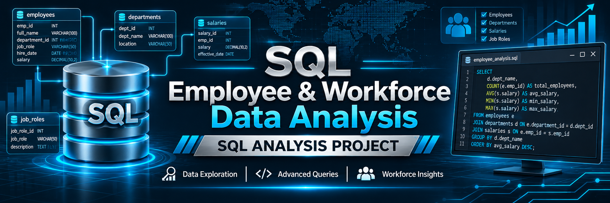
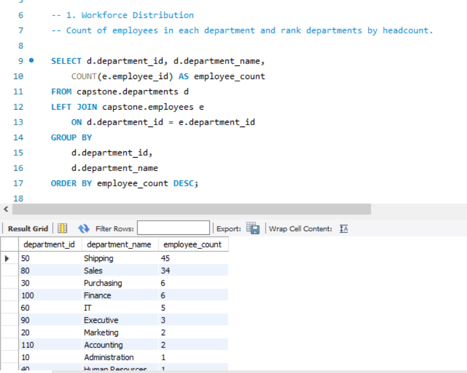
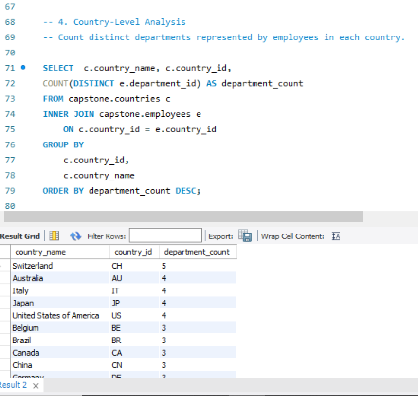
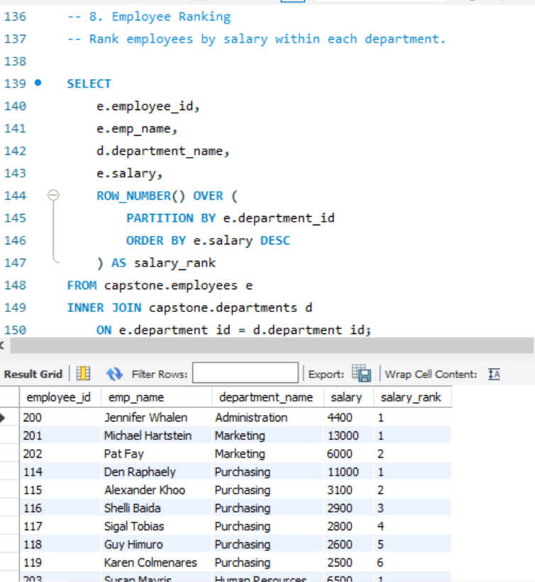

# Orion Data Systems – Workforce Analytics

## Project Overview

This project focuses on analysing workforce data for Orion Data Systems using SQL. The analysis explores employee distribution, salary patterns, departmental structure, job roles, and workforce distribution across different countries.

The project demonstrates how SQL can be used to retrieve, organise, and analyse relational data to answer business questions and support workforce planning.

## Business Background

Orion Data Systems is a fictional organisation with employees distributed across different departments, job roles, and countries.

The organisation needs a clearer understanding of its workforce structure, salary distribution, and departmental composition to support better human resource planning and decision-making.

## Business Problem

Without structured workforce analysis, management may find it difficult to understand employee distribution, compare salary patterns, identify staffing gaps, and evaluate workforce costs across departments and countries.

This project uses SQL queries to explore these areas and provide useful insights from the available workforce database.

## Project Objectives

The main objectives of this project are to:

- Analyse employee headcount across departments.
- Calculate and compare average salaries by department.
- Classify employees into salary bands.
- Examine workforce distribution across countries and departments.
- Identify employees earning above the overall average salary.
- Explore departmental management and reporting structures.
- Identify job roles with higher average salaries.
- Rank employees by salary within their departments.
- Calculate total salary costs across countries.
- Identify job roles that currently have no employees.

## SQL Query Preview

The screenshots below will showcase selected SQL queries from the project, demonstrating basic, intermediate, and advanced SQL techniques.

### 1. Basic SQL Analysis

### 2. Joins and Subqueries

### 3. Advanced SQL Analysis

[View the Complete SQL Project File](abigail-abilawon.sql)

## Database Overview

The project uses a MySQL relational database named `capstone`.

The database contains four main tables:

| Table | Description |
|---|---|
| employees | Contains employee information, including salary, department, and job details |
| departments | Contains department information and management details |
| jobs | Contains job titles and salary-related information |
| countries | Contains country information associated with the workforce |

These tables were used to perform queries involving filtering, aggregation, and relationships between tables.

## SQL Analysis and Business Questions

The project addresses ten business questions using SQL:

| No. | Business Question | SQL Techniques |
|---|---|---|
| 1 | How many employees are in each department? | COUNT, GROUP BY |
| 2 | What is the average salary in each department? | AVG, GROUP BY |
| 3 | How can employees be classified into salary bands? | CASE |
| 4 | How is the workforce distributed across countries and departments? | JOIN, GROUP BY |
| 5 | Which employees earn above the overall average salary? | Subquery |
| 6 | Who are the department managers, and how are reporting relationships structured? | JOIN |
| 7 | Which job roles have an average salary above 12,000? | CTE, AVG, HAVING |
| 8 | How do employees rank by salary within their departments? | ROW_NUMBER, PARTITION BY |
| 9 | What is the total salary cost across each country? | SUM, GROUP BY |
| 10 | Which job roles currently have no employees? | RIGHT JOIN, NULL filtering |

## Business Insights and Interpretation

The SQL analysis provides a structured way to examine the organisation's workforce.

The queries help explore:

- Employee distribution across departments and countries.
- Differences in average salary between departments.
- Salary classifications and employees earning above the overall average.
- Management and reporting relationships.
- Higher-paying job roles and employee salary rankings.
- Potential staffing gaps where job roles have no assigned employees.
- Total salary expenditure across countries.

These areas provide useful information for understanding workforce composition and identifying areas that may require further investigation.

## Business Recommendations

Based on the areas explored in the analysis, the following actions may support better workforce management:

1. **Departmental Planning:** Review employee distribution across departments to identify possible staffing imbalances.
2. **Salary Review:** Compare salary patterns across departments and job roles to support compensation planning.
3. **Workforce Cost Management:** Monitor total salary expenditure across countries to support budgeting.
4. **Staffing Review:** Investigate job roles without assigned employees to determine whether recruitment or restructuring is necessary.
5. **Management Structure:** Review reporting relationships to support clear departmental accountability.

## SQL Concepts and Techniques Used

The project demonstrates the use of:

- SELECT and WHERE statements
- COUNT, AVG, and SUM functions
- GROUP BY and ORDER BY
- CASE statements
- INNER JOIN and RIGHT JOIN
- Subqueries
- Common Table Expressions (CTEs)
- HAVING clause
- NULL filtering
- Window functions
- ROW_NUMBER()
- PARTITION BY

## Tools Used

- **MySQL:** Database querying and workforce data analysis.
- **SQL:** Data retrieval, aggregation, joining, and analysis.

## Project Deliverables

The repository contains:

- SQL project file with the ten analysis exercises.
- README documentation explaining the project, database structure, analysis, and recommendations.
- Selected SQL query screenshots demonstrating different SQL techniques.

## Conclusion

This project provided practical experience in using MySQL to analyse relational workforce data and answer business-related questions.

Through ten SQL exercises, I applied different querying techniques, including aggregation, joins, subqueries, CTEs, and window functions.

The project strengthened my understanding of SQL and demonstrated how structured data analysis can support workforce planning and business decision-making.
